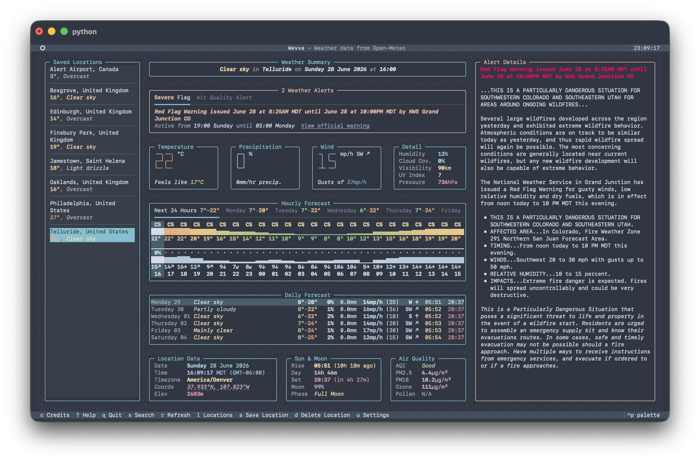
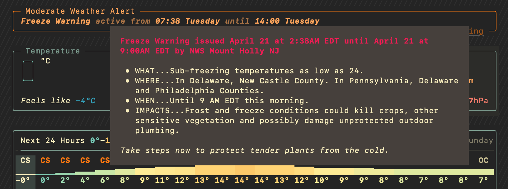

# wevva

`wevva` is a weather TUI built with [Textual](https://textual.textualize.io/) and powered by [Open-Meteo](https://open-meteo.com/).

<p align="center">
  
</p>

## Highlights

- Place search using Open-Meteo geocoding
- Current, hourly, and daily forecasts with detailed weather parameters and keyboard navigation
- Current and upcoming weather alerts (normalized provider data)
- Global active tropical-system investigation with source-specific tracks and official products
- Interactive Braille world map for spatial navigation between saved locations
- Clickable temperature-labelled cities on country and regional weather maps
- Unit preferences (temperature, wind, precipitation)
- Theme toggle and optional emoji rendering
- Interactive setup wizard for defaults
- Reusable Python API (async + sync helpers)

> [!NOTE]
> - The primary forecast has a compact, non-scrolling 80x24 mode. When height
>   permits, its existing location, astronomy, air-quality, and country-map
>   widgets return as a density-aware context matrix. Once the forecast reaches
>   its full width, wider layouts can move location and astronomy above a
>   larger, lower-density country map in a right-hand column to save rows.
>   Full-height windows restore the complete bottom matrix, including air
>   quality, while still admitting saved-location and warning-detail rails. The
>   tropical workspace has not yet received the same redesign.

## Quick Start

First, install [uv](https://docs.astral.sh/uv/):

```bash
curl -Ls https://astral.sh/uv/install.sh | sh
```

Then, using `uvx`, run `wevva`:

```bash
uvx wevva
```

to launch the app without cloning the repo. This will install `wevva` as a package in a temporary environment and run it from there.

Alternatively, you can clone the repo and run from the local source:

```bash
uvx --from . wevva
```

Requires Python `>=3.12`.

## First-Time Setup

> [!TIP]
> Run the setup wizard to save defaults:
>
> ```bash
> uvx wevva setup
> ```

Save settings without launching:

```bash
uvx wevva setup --no-launch
```

## Useful Commands

```bash
# Start normally (uses saved defaults)
uvx wevva

# Start directly at a location (picks first geocoding match, might not be what you expect!)
uvx wevva --location "Edinburgh"

# One-run overrides
uvx wevva --theme dracula --emoji
uvx wevva --temperature-unit fahrenheit --wind-speed-unit mph

# Manage saved default location
uvx wevva --set-default-location "New York"
uvx wevva --clear-default-location
```

When a startup location is available, wevva opens on the Dashboard; press `w`
for the full Weather screen. With no configured location it opens place search
first.

> [!WARNING]
> - Emoji rendering support varies depending on terminal support and is disabled by default. Enable it with `--emoji` (or via `wevva setup`).
> - Colour support also varies. Try `export COLORTERM=truecolor` if colours display strangely.

## Weather Alerts

<p align="center">
  
</p>

- Weather alerts use my [`wevva-warnings`](https://github.com/njf0/wevva-warnings) library.
  - Because we fetch all alerts for the searched location's country, then filter them by the forecast location coordinates, this may take a minute or two if there are many alerts in the country.
- A bordered alert summary upgrades to the classic tabbed preview when height permits. Activating either form opens a modal where those tabs directly select the full, independently scrolling provider document; wide layouts retain the automatic detail/map sidebar.
- During a background warning check, the header subtitle briefly reads `Checking warnings…` and then returns to `Powered by Open-Meteo`; warning status does not create toast notifications.
- Where a provider includes an official alert URL, `wevva` shows it directly on the alert panel so you can jump out to the source document.
- We use the latitude and longitude coordinates of the forecast location in combination with the warning provider-issued polygon data. Some countries/providers don't issue polygon data, so we are unable to show alerts for those locations.
- Warning maps use Unicode Braille, with full Braille cells for filled interiors and partial cells along geographic edges.

Press `g` from the weather screen to open the country Alerts Centre. It keeps
country discovery separate from alerts applicable to the current forecast
point, and combines a searchable active-alert list, complete provider
documents, issued warning polygons, and locally selectable settlement labels.
Hovering or keyboard-highlighting a warning row previews its polygon at full
severity without selecting or zooming it. Activate a selected warning again to
return to the full-country overview.
Hovering a settlement shows compact current conditions; clicking it opens that
place's complete forecast on the main Weather screen. Returning with `g`
restores the previous Alerts Centre context. Use `r` to refresh its independent
alert data and `w` to return to weather.

## Tropical Systems

Press `t` from the weather screen to open the global Active Tropical Systems
workspace. Canonical storm names are shown once, while each issuing centre's
meteorology, track, and lazily retrieved official products remain separate.
The main weather screen retains only nearby-storm awareness and
location-specific alert detail.

The track uses a fitted global Natural Earth backdrop, centred position dots,
and a provider cone when available. On this screen, `t` toggles the position
dots, `c` toggles the cone, `r` refreshes the tropical data and `w` returns to
weather.

## Library Usage

This library is designed to be used as a TUI, but I have also exposed a minimal set of functions for fetching weather data and geocoding that can be used in other Python contexts. These are available as both async and sync versions, depending on your needs.

Install as a package:

```bash
uv add wevva
```

Simple sync usage (nice for scripts):

```python
from wevva import forecast_by_place_sync

bundle = forecast_by_place_sync("Edinburgh")
print(bundle.metadata.name, bundle.metadata.country)
print(bundle.current.get_temperature(), bundle.current.forecast_units.get("temperature_2m"))
```

Async usage (best for apps/services):

```python
import asyncio
from wevva import forecast_by_coordinates

async def main() -> None:
    bundle = await forecast_by_coordinates(lat=55.9533, lon=-3.1883)
    print(bundle.daily.get_temperature_max(0))
    print(bundle.hourly.get_condition_abbreviation(0))

asyncio.run(main())
```

You can also geocode from Python:

```python
from wevva import geocode_sync

matches = geocode_sync("Glasgow", count=3)
for match in matches:
    print(match.name, match.country, match.latitude, match.longitude)
```

Fetch alerts by coordinates:

```python
from wevva import alerts_by_coordinates_sync

alerts = alerts_by_coordinates_sync(lat=39.7456, lon=-97.0892, country_code="US")
for alert in alerts:
    print(alert.event, alert.severity, alert.expires)
```

## Weather-Screen Keys

- `s` search for place
- `r` refresh weather
- `a` save current location
- `d` delete highlighted saved location
- `l` focus saved locations when its automatic rail is visible; otherwise open it
- `m` open the interactive saved-locations world map
- `i` focus warning details when its automatic rail is visible; otherwise open them
- `g` open the country Alerts Centre
- `t` investigate active tropical systems
- `u` open settings
- `h` or `?` open help
- `c` credits
- `q` quit

The Tropical Systems screen has its own contextual `t`/`c` track controls;
press `h` in the application for the complete shortcut guide.
On the saved-locations world map, use left/right to move between city labels,
then Enter or Space to open the focused forecast; mouse selection works too.
Location-map city labels can likewise be clicked or focused and activated to
open their ordinary weather forecast. Activating an Alerts Centre settlement
also opens its ordinary full forecast; hovering first shows a compact current-
weather tooltip without leaving the warning map.

## Config

Preferences are stored at:

```text
~/.config/wevva/config.json
```

Saved settings include:
- units
- theme
- emoji preference
- default location (and cached resolved location metadata)
